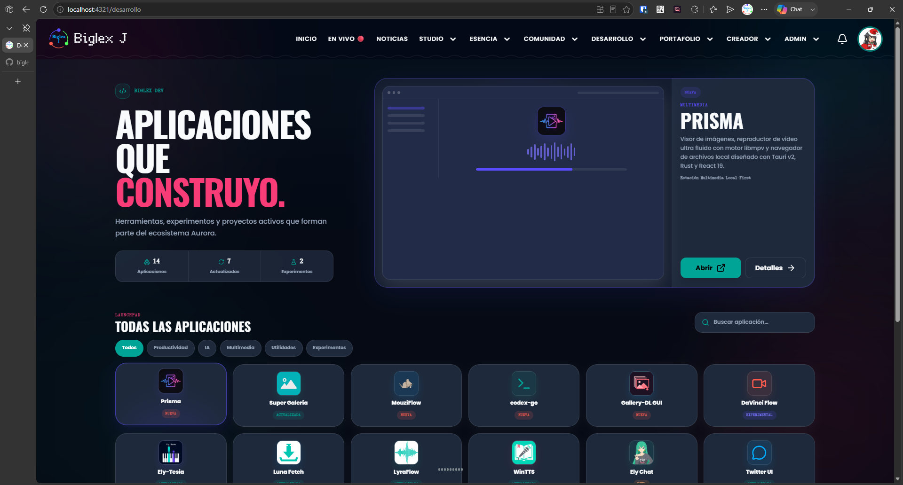
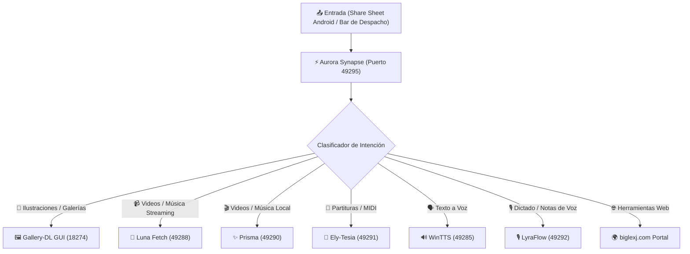

# ⚡ Aurora Synapse

> **Orquestador Universal, Clasificador de Intención y Launchpad Multiplataforma para el Ecosistema Aurora.**

[](LICENSE)
[](https://v2.tauri.app)
[](#)
[](https://github.com/biglexj/Aurora-Synapse/releases)
[](https://biglexj.com)

---

## 📸 Capturas de Pantalla

| Modo oscuro | Modo claro |
| :---: | :---: |
|  |  |

---

## 🏛️ ¿Qué es Aurora Synapse?

**Aurora Synapse** es la aplicación central de despacho y enrutamiento inteligente del ecosistema **biglexj**. Actúa como el puente universal de comunicación tanto entre dispositivos (teléfono Android ↔ PC con Windows) como entre aplicaciones satélite nativas y herramientas web.

En lugar de requerir emparejamientos individuales en cada aplicación, **Aurora Synapse** recibe el contenido desde el *Share Sheet* de Android o la barra de despacho en PC, analiza la intención mediante reglas deterministas de dominio y tipo MIME, y enruta el payload inmediatamente a la aplicación especializada correcta:



---

## ✨ Características Principales

- 🧠 **Clasificador Inteligente de Intención**: Detección en tiempo real de URLs, redes sociales (YouTube, TikTok, Twitter/X), plataformas de arte (DeviantArt, Pixiv, ArtStation) y extensiones de archivo locales (`.mid`, `.mp4`, `.m4a`, `.txt`).
- 🚀 **Launchpad Unificado del Ecosistema**:
  - Pestaña **`Aplicaciones`**: Catálogo de aplicaciones nativas instalables con insignias de estado (*NUEVA*, *ACTUALIZADA*, *EXPERIMENTAL*, *PROXIMAMENTE*).
  - Pestaña **`Web`**: Suite completa de herramientas de desarrollo, estudio musical, chat comunitario y analíticas de `biglexj.com`.
- 📐 **Diseño Fluido y Rejilla Adaptativa**: Aprovechamiento total del 100% del ancho de pantalla con escalado dinámico de 2 a 6 columnas.
- ⚙️ **System Tray & Residencia en Segundo Plano**: Minimización a la bandeja del sistema al presionar `X` para escucha reactiva permanente en segundo plano.
- 🔄 **Persistencia de Ventana**: Recuerda automáticamente tamaño, posición y estado de maximizado (`tauri-plugin-window-state`).
- ⚡ **Auto-Run**: Opción de inicio automático con Windows sin fricción.

---

## 📦 Distribución Oficial

| Artefacto | Archivo | Notas |
| :--- | :--- | :--- |
| Windows x64 | `Aurora-Synapse-v1.0.1-Setup.exe` | Instalador oficial **Inno Setup** (`packaging/windows/setup.iss`). Instalación por usuario, sin elevación. |
| Android | `Aurora-Synapse-v1.0.1.apk` | APK universal autónomo. Variante `debug` firmada con la clave de depuración: requiere habilitar *fuentes desconocidas* y no sirve para tiendas. |
| Sumas | `SHA256SUMS.txt` | SHA-256 **solo** de los dos artefactos publicados. Verificar con `sha256sum -c SHA256SUMS.txt`. |

- El instalador de Windows se genera con la plantilla compartida de Biglex en Inno Setup; la migración desde el instalador anterior está en [`packaging/windows/MIGRATION.md`](packaging/windows/MIGRATION.md).
- La versión canónica vive en `package.json` y se propaga a `tauri.conf.json`, `Cargo.toml`, el instalador y el APK. El número de versión visible en *Acerca de* y el del endpoint `GET /status` deben coincidir con ella.
- WebView2 Runtime debe estar disponible en el equipo donde se instala.

---

## 🛠️ Desarrollo Local

### Puente MCP — consolidación en curso

El [proceso activo de puente universal MCP e interconectividad](process/active/2026-10-26_puente-universal-mcp-e-interconectividad/PLAN.md)
define la evolución hacia operación mediante agentes (incluidos Codex y Ely Intelligence)
y acciones entre teléfono y PC. Es un objetivo por etapas; no implica soporte completo actual.

La entrega actual se acota a la [base común MCP y prueba de conexión con Aurora](docs/mcp/FOUNDATION.md),
como preparación de 1.1.0. Las descargas, nuevas integraciones y ampliaciones teléfono ↔ PC se aplazan.
El recurso `aurora-synapse://capabilities` publica el contrato implementado sin ejecutar acciones.

El puente publica 20 herramientas para Luna Fetch, Prisma, Prisma Upscaler y Super Galería,
además de descubrimiento y clasificación. Las demás integraciones están aplazadas.
Consultar el [plan vigente](docs/mcp/PLAN.md) y la [verificación realizada](docs/mcp/VERIFICATION.md).

- HTTP local: `http://127.0.0.1:49296/mcp`, con Synapse abierto o ejecutando
  `aurora-synapse.exe --mcp-http`.
- stdio: configurar el cliente MCP para lanzar el ejecutable con `--mcp-stdio`.
- Sonda: `./scripts/mcp/bridge-probe.ps1 -Tool apps_list`.
- Verificación del binario y escalado real: `node scripts/mcp/verify-local.mjs`
  después de compilar Rust. Requiere Prisma Upscaler CLI instalada y GPU compatible
  con FSR1; crea un PNG nuevo en `%TEMP%`.

`apps_list` distingue el soporte del adaptador (`supported`) de la respuesta del
servicio (`reachable`). `cli_available` indica CLI instalada, sin garantizar GPU
o modelos. Las acciones informan `delivery`: `sent`, `accepted` o `completed`.
El escalado confirma una salida PNG nueva. Las transferencias de Super Galería verifican tamaño y SHA-256; las descargas nunca sobrescriben.

El cliente de Ely Intelligence requiere `AURORA_SYNAPSE_MCP_URL` apuntando al puente
desde el equipo donde corre su backend. Para escalado, configurar
`AURORA_SYNAPSE_TIMEOUT_MS=150000` en ese consumidor; el backend local ya usa ese valor.
Una URL loopback no conecta un backend alojado en otro servidor con este PC.

### Requisitos
- [Bun](https://bun.sh) (v1.1+)
- [Rust](https://www.rust-lang.org) (v1.85+)
- [Android Studio & NDK](https://developer.android.com) (opcional para compilar en Android)
- [ImageMagick](https://imagemagick.org) (para regenerar iconos)

### Iconos

```bash
# Sincroniza los iconos del ecosistema y regenera el set de Tauri
bun run sync:icons
```

El script toma la fuente canónica de
`D:\Imágenes\03_Proyectos\02_Development\Icons\Applications\Aurora-Synapse` y deja:

- `Aurora-Synapse.webp` → icono de escritorio y de la app (variante con fondo).
- `Aurora-Synapse-transparent.webp` → **icono del launcher de Android**.

El launcher de Android usa iconos adaptativos de 108×108dp: la máscara del
launcher solo deja ver el **círculo interior de 66dp**. Por eso la capa
*foreground* se genera con el artwork reducido al 48% del lienzo y fondo
transparente, y la capa *background* aporta el color. Si el artwork se
coloca a pantalla completa, los brazos del emblema se cortan en el móvil.
El manifiesto `assets/branding/icons/tauri/icon-manifest.json` deja esos
valores ajustados en un solo sitio.

### Iniciar en Desarrollo
```bash
# Instalar dependencias
bun install

# Ejecutar aplicación de escritorio en modo desarrollo
bun run tauri dev
```

### Operación con Mise (Estándar Ecosistema)

Aurora Synapse implementa la interfaz universal de tareas mediante Mise:

| Tarea | Propósito |
|---|---|
| `mise dev` | Ejecutar en modo desarrollo (`tauri dev`). |
| `mise build` | Compilar frontend y binario de escritorio sin generar instaladores. |
| `mise check` | Verificar tipos de TypeScript y el código Rust sin emitir artefactos de distribución. |
| `mise test` | Ejecutar las pruebas unitarias del módulo Rust del puente MCP. |
| `mise release` | Generar distribuibles locales en `release/` (Setup `.exe`, APK y `SHA256SUMS.txt`) sin publicar. |
| `mise publish` | Publicar en GitHub Releases y sincronizar ficha en Aurora. Es explícito y exige autorización: no se ejecuta como efecto secundario de `build` ni de `release` (`--plan` y `--check` sin escritura). |

Opciones de inspección y comprobación:
- `--plan`: Muestra el comando y las operaciones planificadas sin ejecutar procesos ni modificar el sistema (`mise dev --plan`, `mise build --plan`, `mise check --plan`, `mise test --plan`, `mise release --plan`, `mise publish --plan`).
- `--check`: (para `publish`) Verifica el estado del repositorio, tags, notas y la presencia e integridad de los artefactos en `release/` sin publicar nada (`mise publish --check`).
- Canal explícito `github`: `mise publish github` (omite la sincronización con la web de Aurora).

La arquitectura local (stack, puertos, mapa del repositorio y decisiones de producto) está en [`docs/architecture.md`](docs/architecture.md). El protocolo Aurora Synapse y sus contratos (puertos, payloads, URI y puente MCP) tienen su fuente canónica en la documentación Core del ecosistema, no en este repositorio.

### Flujos directos auxiliares

```bash
# Compilar e Instalar en Android
powershell.exe -ExecutionPolicy Bypass -File .\scripts\build\install-android.ps1

# Empaquetar el Instalador de Windows (sin publicar)
powershell.exe -ExecutionPolicy Bypass -File .\scripts\packaging\Build-Installer.ps1

# Empaquetar la Release completa localmente (equivalente a mise release)
powershell.exe -ExecutionPolicy Bypass -File .\scripts\build\build-release.ps1 -LocalOnly
```

---

## 📜 Licencia & Autor

- **Licencia**: GNU General Public License v2.0 (`GPL-2.0`)
- **Autor**: [Biglex J](https://www.biglexj.com) (2026)
- **Donaciones Oficiales**: [biglexj.com/donaciones](https://www.biglexj.com/donaciones) · [Buy Me a Coffee](https://buymeacoffee.com/biglexj)
